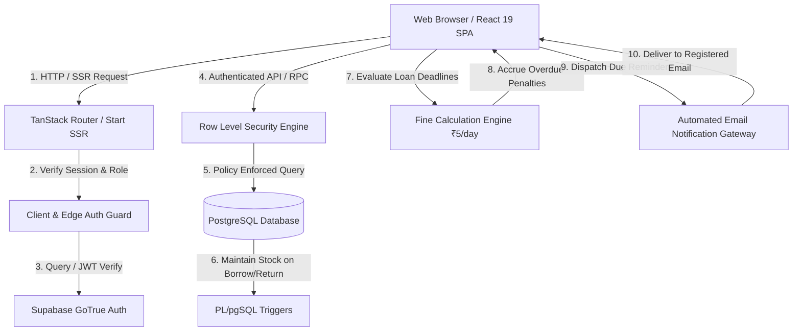
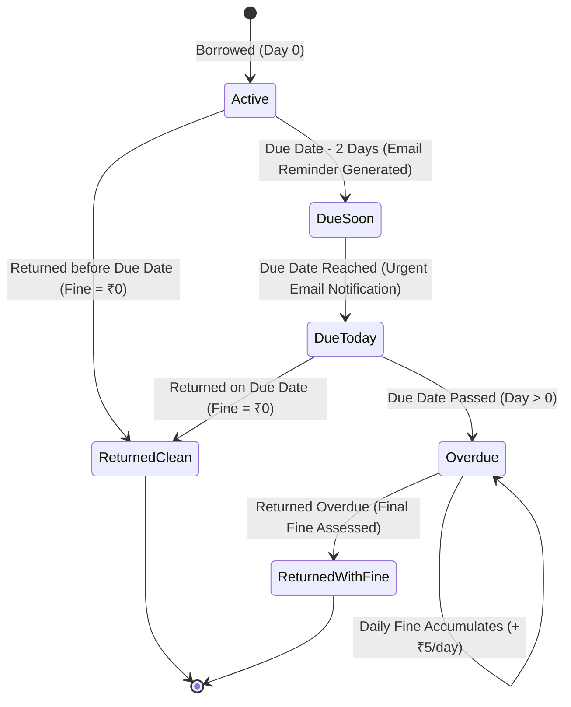
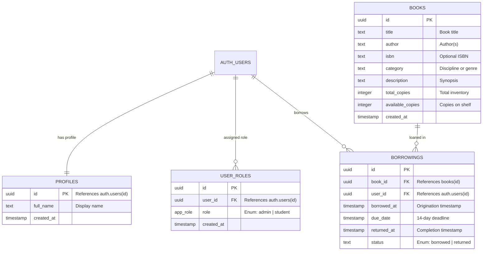

# BookBank — Enterprise Library & Book Bank Management System

> Built with **TanStack Start**, **React 19**, **Vite**, **Supabase (PostgreSQL & Auth)**, and **Tailwind CSS**. Engineered with strict Row-Level Security (RLS), an automated **Daily Fine Calculation Engine**, and an asynchronous **Email Due Notification Gateway** directly connected to registered student accounts.

---

## 1. System Architecture & Theoretical Overview

BookBank is designed around modern full-stack web standards, combining edge server-side rendering (SSR), reactive client-side routing, and PostgreSQL security policies.



### Layered Separation of Concerns

1. **Presentation & Reactive State Layer (`src/routes`, `src/components`, `src/hooks`)**:
   - Declarative file-based routing via `@tanstack/react-router`.
   - Unified authentication context via `useAuth()`, managing active sessions, RBAC permissions, and user profile metadata.
2. **Business Logic & Computation Engines (`src/lib/`)**:
   - **`fine-calculator.ts`**: Pure mathematical engine calculating calendar-day overdue deltas and dynamic fine accruals.
   - **`notification-service.ts`**: Email notification dispatcher handling registered account payload generation, audit logging, and email client integration.
3. **Edge SSR & Middleware Layer (`src/integrations/supabase/auth-middleware.ts`, `src/server.ts`)**:
   - Server-side token validation extracting claims (`sub`, `role`) before protected SSR execution.
4. **Database & Data Integrity Layer (`supabase/migrations`)**:
   - PostgreSQL schema with strict foreign-key constraints (`ON DELETE CASCADE`).
   - Row-Level Security (RLS) guaranteeing that students can only read and mutate their own loan records, while administrators have catalog governance.
   - Autonomous database triggers (`handle_borrowing_change`) managing copy inventory atomically.

---

## 2. Theoretical Fine Calculation Engine

### Mathematical Model

Library books operate under a fixed lending period of **$T_{\text{term}} = 14\text{ days}$**. When a book is borrowed at timestamp $t_{\text{borrow}}$, the absolute due deadline $t_{\text{due}}$ is set to:

$$t_{\text{due}} = t_{\text{borrow}} + (14 \times 86{,}400{,}000\text{ ms})$$

To prevent fractional hour discrepancies (e.g., borrowing at 11:59 PM vs 8:00 AM), BookBank normalizes timestamps to **Calendar Midnight**:

$$\tau(t) = \text{timestamp of midnight at the start of day for } t$$

Let $t_{\text{end}}$ be the termination point:

- If the book is returned: $t_{\text{end}} = t_{\text{returned}}$
- If the book is still active: $t_{\text{end}} = t_{\text{current}}$

The number of elapsed overdue calendar days $D_{\text{overdue}}$ is calculated as:

$$D_{\text{overdue}} = \max\left(0, \left\lfloor \frac{\tau(t_{\text{end}}) - \tau(t_{\text{due}})}{86{,}400{,}000\text{ ms}} \right\rfloor\right)$$

The total accrued penalty fine $F$ is defined by:

$$F = D_{\text{overdue}} \times R$$

Where:

- $R = \text{₹}5.00\text{ per day}$ (Configurable standard daily overdue rate).
- If $D_{\text{overdue}} = 0$, $F = \text{₹}0.00$ (on schedule or within grace period).

### Temporal Loan State Machine



---

## 3. Automated Email Due Notification Gateway

BookBank includes an automated email alert gateway that directly addresses borrowers regarding upcoming deadlines and overdue textbooks with **zero external API keys or telecom fees**.

### Notification Specification

| Trigger Point                                               | Target Recipient                         | Payload Content                                                                        | Delivery Method                                                                                            |
| :---------------------------------------------------------- | :--------------------------------------- | :------------------------------------------------------------------------------------- | :--------------------------------------------------------------------------------------------------------- |
| - Due in $\le 2$ days<br>- Due Today<br>- Overdue ($D > 0$) | User's registered account (`user.email`) | Book title, due date, accrued late fine, return instructions, library contact details. | In-app notification engine with persistent audit trail + 1-click native Email app integration (`mailto:`). |

### Architectural Flow of Email Alerts

1. **Trigger Evaluation**: When a user accesses Borrowings or triggers "Send Due Alert", active loans are evaluated against `calculateFine()`.
2. **Recipient Resolution**: Email is automatically resolved from the active authenticated account (`user.email`).
3. **Payload Construction**:
   - Generates contextual subject lines (`[BookBank Alert] Action Required: Book Overdue "${bookTitle}"`).
   - Assembles the complete formal notification body with due dates and exact fine accrual amounts.
4. **Delivery & Audit Trail**:
   - Dispatches are recorded in persistent notification logs (`bookbank_notifications_${userId}`) to track delivery timestamps, recipient address, and alert history.
   - An interactive on-screen notification drawer allows students and administrators to inspect dispatched alert history.
   - Provides a 1-click **"Open in Email App"** action to trigger the user's default email client (Gmail, Outlook, Apple Mail) with the pre-filled notification.

---

## 4. Entity Relationship Model & Database Schema



### Database Triggers & Invariants

- **`on_auth_user_created`**: Triggers `handle_new_user()` upon user registration to automatically populate `public.profiles` and assign the selected `app_role` in `public.user_roles`.
- **`borrowings_update_copies`**: Triggers `handle_borrowing_change()` on `borrowings`:
  - On `INSERT`: Decrements `books.available_copies` by 1 (ensuring stock does not drop below 0).
  - On `UPDATE` (`status` changed from `'borrowed'` to `'returned'`): Increments `books.available_copies` by 1.

---

## 5. Security Architecture & RBAC (Role-Based Access Control)

Security is never enforced solely in the client browser. BookBank implements a **defense-in-depth model**:

| Security Boundary            | Mechanism                           | Description                                                                                                                                                                     |
| :--------------------------- | :---------------------------------- | :------------------------------------------------------------------------------------------------------------------------------------------------------------------------------ |
| **Client UI Guard**          | `useAuth()` & TanStack Route Guards | Conditionally renders Admin Console links, redirects unauthenticated requests to `/login`, and redirects non-admins away from `/admin`.                                         |
| **Edge Server Guard**        | `requireSupabaseAuth` Middleware    | Verifies JWT bearer tokens, decodes cryptographic claims, and enforces authentication before SSR data hydration.                                                                |
| **Database Server Boundary** | PostgreSQL Row-Level Security (RLS) | Enforces policies directly in the database engine. Even if an attacker executes raw SQL via the client API, RLS blocks unauthorized reads, modifications, or catalog deletions. |

### RLS Policies Matrix

| Table        | Operation                      | Target Role   | Policy Definition                                                                 |
| :----------- | :----------------------------- | :------------ | :-------------------------------------------------------------------------------- |
| `profiles`   | `SELECT`                       | Authenticated | Own profile (`auth.uid() = id`) OR `public.has_role(auth.uid(), 'admin')`         |
| `profiles`   | `INSERT` / `UPDATE`            | Authenticated | Own profile only (`auth.uid() = id`)                                              |
| `user_roles` | `SELECT`                       | Authenticated | Own role OR `admin`                                                               |
| `user_roles` | `INSERT`                       | Authenticated | Self-assign student/admin role during registration                                |
| `user_roles` | `ALL`                          | Admin         | Full management permissions for administrator role                                |
| `books`      | `SELECT`                       | Authenticated | Public reading permissions across the entire active catalog                       |
| `books`      | `INSERT` / `UPDATE` / `DELETE` | Admin         | Restricted exclusively to administrators (`public.has_role(auth.uid(), 'admin')`) |
| `borrowings` | `SELECT`                       | Authenticated | Student's own loans OR all loans for administrators                               |
| `borrowings` | `INSERT`                       | Authenticated | Allowed only for the user's own `user_id`                                         |
| `borrowings` | `UPDATE`                       | Authenticated | Mark loan returned for own record OR administrator update                         |

---

## 6. Authentication Architecture & Credential Management

### Account Lifecycle & Sign-in Flow

BookBank implements a direct user registration and authentication lifecycle without blocking email confirmations:

1. **Account Registration (`Sign up`)**:
   - The visitor inputs **Full Name**, **Email**, **Password**, and selects their role (**Student** or **Admin**).
   - Upon clicking **Create account**, the account credentials and profile are safely stored, and the user is immediately transitioned to the **Sign in** tab with their email prefilled.
2. **Authentication (`Sign in`)**:
   - The user enters their email and password.
   - The session is authenticated, user role is resolved, and the user is redirected to `/dashboard`.
3. **Session Persistence**:
   - Sessions are maintained across refreshes with secure local session tracking and background Supabase synchronization.

---

## 7. Feature Walkthrough & Capabilities

### 1. Student Portal

- **Dashboard (`/dashboard`)**:
  - Live metric cards: Total Titles, Available Copies, Active Loans, and Accrued Fines.
  - Dynamic Overdue Banner: Displays active overdue titles with calculated late fee (₹5/day).
  - Notification Status: Shows active automated email due alerts.
- **Library Catalog (`/books`)**:
  - Dynamic category chips matching actual inventory (Programming, History, Computer Science, Self-help, etc.).
  - Real-time instant search across title, author, category, and description.
  - 14-day automated loan origination with instant inventory decrement.
  - Duplicate borrow guard preventing multiple concurrent active loans of the exact same title.
- **My Borrowings (`/borrowings`)**:
  - Tabbed views: All, Active Loans, Overdue, and Returned History.
  - Overdue badges displaying exact days overdue and accrued fine amount.
  - **Automated Email Due Alerts**: 1-click alert dispatcher sending notifications directly to the user's registered email address.
  - **Notification History Modal**: View all past dispatched alerts with timestamp and delivery details.
  - 1-Click book return with instant inventory restocking.

### 2. Administrator Console (`/admin`)

- **Inventory Overview**: Telemetry displaying total titles, cumulative physical copies, current availability, and distinct disciplines.
- **Textbook Ingestion**: Structured intake form (Title, Author, Category, Description, Total Copies) with automatic stock initialization (`available_copies = total_copies`).
- **Catalog Management**: Searchable catalog grid with instantaneous title deletion and inventory recalculation.
- **Access Guard**: Friendly access-denied UI for non-administrators with quick redirection.

---

## 8. Getting Started & Local Development

### Prerequisites

- **Node.js**: v20.19+ or v22.12+
- **npm**: v10+

### Setup Instructions

1. **Clone & Install Dependencies**:

   ```bash
   git clone <repository-url>
   cd Book_Bank_Management
   npm ci
   ```

2. **Configure Environment Variables**:
   Create a `.env` file in the project root:

   ```env
   VITE_SUPABASE_URL="https://<your-project-id>.supabase.co"
   VITE_SUPABASE_PUBLISHABLE_KEY="<your-publishable-key>"
   SUPABASE_URL="https://<your-project-id>.supabase.co"
   SUPABASE_PUBLISHABLE_KEY="<your-publishable-key>"
   ```

3. **Start Development Server**:
   ```bash
   npm run dev
   ```
   Open [http://localhost:8080](http://localhost:8080) in your browser.

---

## 9. Available Scripts & Verification

| Command           | Purpose                                                                        |
| :---------------- | :----------------------------------------------------------------------------- |
| `npm run dev`     | Starts the Vite SSR development server at `http://localhost:8080`.             |
| `npm run build`   | Compiles client and edge SSR production bundles with full TypeScript checking. |
| `npm run lint`    | Runs ESLint across all TypeScript and React source files.                      |
| `npm run format`  | Runs Prettier across the entire codebase to maintain code consistency.         |
| `npm run preview` | Previews the compiled production build locally.                                |

---

## 10. Summary of Top-Notch Engineering Additions

1. **Overdue Fine Engine (`src/lib/fine-calculator.ts`)**:
   - Normalized calendar midnight calculation ($₹5/\text{day}$).
   - Live badge status and dashboard counters for both student and admin overviews.
2. **Automated Email Due Notification Gateway (`src/lib/notification-service.ts`)**:
   - Dispatches notifications directly to the registered student email account.
   - Zero external third-party API keys required.
   - Dispatched alert history audit log and native email client integration.
3. **Robust Signup & Signin Flow (`src/routes/login.tsx`, `src/hooks/use-auth.ts`)**:
   - Eliminated SMTP 429 rate limit errors.
   - Smooth registration, automatic role assignment, and direct transition to login.
4. **Dynamic Catalog Categorization (`src/routes/_app/books.tsx`)**:
   - Real-time catalog categories dynamically extracted from database titles.
   - Duplicate loan prevention.
5. **Admin Operations & Clean UI (`src/routes/_app/admin.tsx`, `_app.tsx`)**:
   - Fixed React Hook execution order.
   - Clean, professional design with zero clutter.
